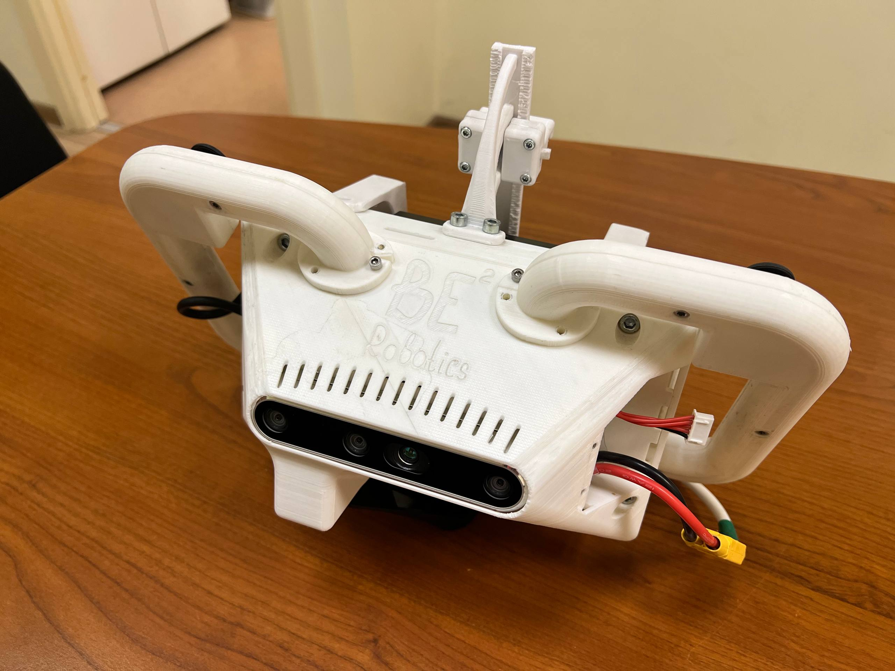
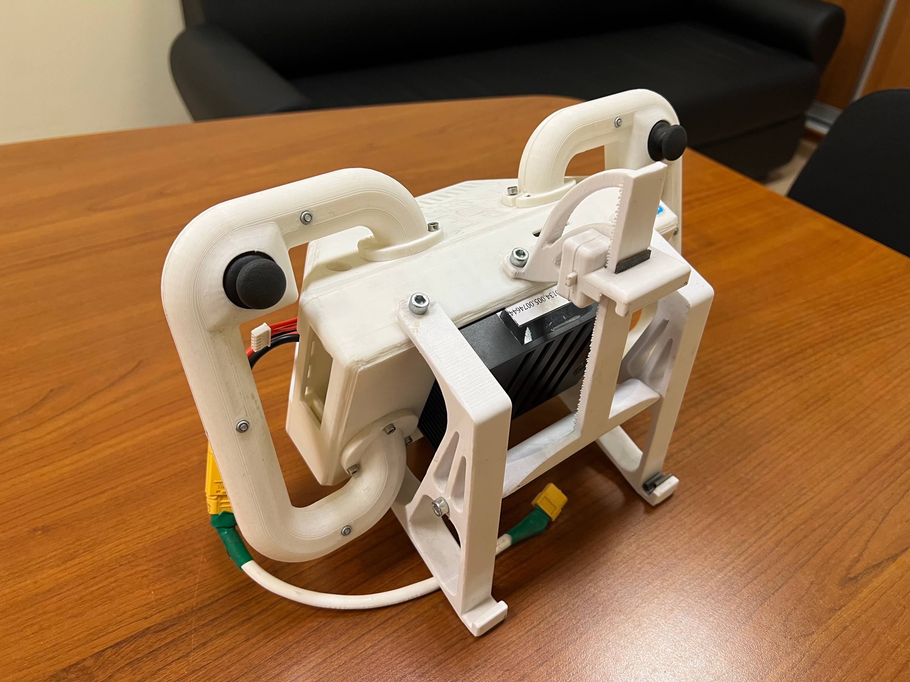

# NVIDIA Jetson AGX Xavier & Intel RealSense D455 Data Recording Guide

This guide provides step-by-step instructions for setting up an **NVIDIA Jetson AGX Xavier** embedded computer paired with an **Intel RealSense D455** depth camera to record ROS 2 bag data.

---

## 1. Hardware Overview & Setup




### System Components:
- **Embedded Computer**: NVIDIA Jetson AGX Xavier Development Kit
- **Depth Camera**: Intel RealSense D455
- **Power Options**:
  - 19V DC Power Adapter (for stationary desk work)
  - 4S LiPo Battery (for mobile 3D scanning)
- **Peripherals & Hub**:
  - USB Type-C to USB-A hub (for connecting standard USB peripherals)
  - USB Keyboard & Mouse
  - HDMI Cable & External Monitor
- **Networking**: RJ45 Ethernet cable (no onboard Wi-Fi card by default)

---

## 2. Power Supply Options

The Jetson AGX Xavier is powered via the onboard DC barrel jack. Choose the appropriate power source based on your task:

| Power Source | Port | Use Case |
| :--- | :--- | :--- |
| **19V DC Power Adapter** | Onboard DC barrel jack | **Configuration, Development & Coding**: Always use the 19V adapter when setting up the system, building packages, compiling workspaces, and running stationary tests to prevent unexpected power drops. |
| **4S LiPo Battery** | Onboard DC barrel jack | **Mobile / Portable Scanning**: Use a charged 4S battery when moving around with the setup to capture and record 3D scan data in the field. |

> ⚠️ **Important:** Verify correct voltage range and polarity before connecting battery power to the DC barrel jack.

---

## 3. Peripheral & Network Connections

Perform the following hardware connections before booting:

1. **Power Supply**: Connect either the 19V DC adapter or the 4S battery to the DC barrel jack.
2. **Keyboard & Mouse**: Plug a **USB Type-C to USB-A hub** into one of Xavier's Type-C ports, then connect the keyboard and mouse to the hub.
3. **Display**: Connect an external monitor to the Xavier via the **HDMI port**.
4. **Camera**: Connect the **Intel RealSense D455** to a high-speed USB 3 port on the board.
5. **Internet Connection**: By default, the Xavier does **not** have a built-in Wi-Fi card. If you need network connectivity to clone repositories or install software packages, connect an **RJ45 Ethernet cable** to the Ethernet port.

---

## 4. System Login & Operating System Details

Once powered on and the system boots:

- **Username**: `itmo`
- **Password**: `1`

### Host Operating System & Docker Requirement
- The host OS installed on this Xavier is **Ubuntu 20.04 LTS (JetPack)**.
- Because newer ROS 2 distributions (such as ROS 2 Humble or Iron) are not natively supported on Ubuntu 20.04, ROS 2 is executed inside a **Docker container**.
- Docker allows running modern ROS 2 environments with access to hardware acceleration (NVIDIA GPU and USB camera pass-through).

---

## 5. Software Setup: ROS 2 via Docker

A template repository for running ROS in Docker is available here:  
🔗 **[https://github.com/huynhtancuong/ros_docker_template.git](https://github.com/huynhtancuong/ros_docker_template.git)**

### 5.1 Clone and Run the Docker Template

Open a terminal on the host (`Ctrl + Alt + T`):

```bash
# Clone the ROS Docker template repository
git clone https://github.com/huynhtancuong/ros_docker_template.git ~/ros_docker_template
cd ~/ros_docker_template

# Follow the repository instructions to launch and attach to the container
bash docker/build.bash
bash docker/run.bash
bash docker/into.bash
```

> 💡 **Tip:** Ensure the Docker run configuration mounts a shared volume (e.g. `-v ~/ros_docker_template/workspace:/root/workspace`) between the host and the container so that recorded files persist on the host.

---

## 6. Setting Up RealSense ROS 2 Driver

Once inside the Docker container:

### 6.1 Clone the RealSense ROS Repository
Navigate to your ROS 2 workspace source directory:

```bash
cd /workspace/src
git clone https://github.com/realsenseai/realsense-ros.git
```

### 6.2 Install Dependencies & Build Workspace

```bash
cd /workspace
apt-get update
rosdep update
rosdep install -i --from-path src --rosdistro $ROS_DISTRO -y

# Build the workspace
colcon build --symlink-install

# Source the workspace setup file
source install/setup.bash
```

---

## 7. Step-by-Step Workflow for Recording ROS Bags

Follow this operational workflow to launch the camera and record rosbag data:

### Step 1: Launch the RealSense Camera Node
Inside the Docker container terminal, run:

```bash
ros2 run realsense2_camera realsense2_camera_node
```

You can verify that topics are active by opening a second terminal inside the Docker container:
```bash
ros2 topic list
```

### Step 2: Record the ROS 2 Bag
In another terminal inside the container (or in the background):

```bash
# Navigate to your workspace or data directory first
cd /workspace

# Record all published topics
ros2 bag record -a
```

*Note: If you only want to record specific camera topics (such as color, depth, and camera info) to save storage, you can specify them:*
```bash
ros2 bag record /camera/camera/color/image_raw /camera/camera/depth/image_rect_raw /camera/camera/camera_info
```

### Step 3: Stop Recording
When you have finished scanning:
- Switch to the terminal running `ros2 bag record`.
- Press `Ctrl + C` to safely stop the recording and finalize the bag database.

### Step 4: Access Bag Files on the Host Machine
- The recorded rosbag folder will be created in whichever directory you were in when executing `ros2 bag record`.
- If you did not run the command inside the mounted volume directory, copy the generated bag directory into the mounted workspace folder:

```bash
cp -r <rosbag_directory_name> /workspace/
```

- Because `/workspace` is mapped to a folder on the host machine through Docker volume mounting, you can now immediately access, copy, or process the bag files directly from the host Ubuntu 20.04 system without needing to export files out of Docker.

---

## 8. Quick Reference Cheatsheet

```bash
# ========================================================
# Inside Docker Container
# ========================================================

# 1. Source the environment
source /opt/ros/$ROS_DISTRO/setup.bash
source /workspace/install/setup.bash

# 2. Launch RealSense Node
ros2 run realsense2_camera realsense2_camera_node

# 3. Record Bag (in a second container terminal)
cd /workspace
ros2 bag record -a

# 4. Stop Recording
# Press Ctrl + C

# 5. Access files on Host machine
# The bag files are located in the host directory mapped to /workspace
```
